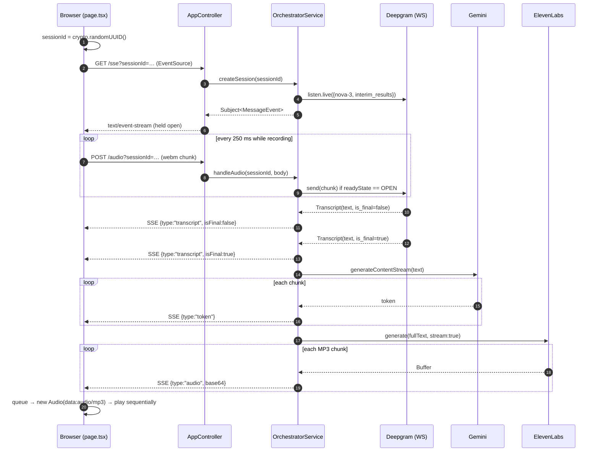

# Architecture: SSE-chat-ai

| | |
|---|---|
| Last updated | 2026-11-16 |
| Related | [PRD.md](./PRD.md) |
| Scope | `server/` (NestJS backend) and the parts of `client/` (Next.js) that talk to it |

---

## 1. Overview

SSE-chat-ai is a **streaming voice pipeline**:

```
Mic audio ──► STT (Deepgram) ──► LLM (Gemini) ──► TTS (ElevenLabs) ──► Speaker
```

The browser **uploads** audio with `POST /audio` and **receives** everything else (transcripts, LLM tokens, audio) on one long-lived **Server-Sent Events** stream, `GET /sse`. On the server, a single `OrchestratorService` holds per-session state and wires the three provider services together using callbacks and an RxJS `Subject`.

**Mental model:** think of an interpreter booth. The mic is the speaker. Deepgram is the stenographer, Gemini is the expert who writes the answer, and ElevenLabs is the voice actor. The SSE stream is the loudspeaker wire back to the listener, and the orchestrator is the booth manager passing paper between them.

## 2. Tech stack

| Layer | Technology |
|---|---|
| Frontend | Next.js (App Router), React hooks (`useAudioRecorder`, `useSSE`), `MediaRecorder`, `EventSource` |
| Backend | NestJS 11 on Express (`@nestjs/platform-express`), RxJS 7 |
| Speech-to-text | Deepgram live WebSocket (`@deepgram/sdk` v4, model `nova-3`, `en-US`) |
| LLM | Google Gemini (`@google/generative-ai`, model `gemini-1.5-flash`, streaming) |
| Text-to-speech | ElevenLabs (`elevenlabs` SDK, model `eleven_turbo_v2_5`, voice "Rachel", streaming MP3) |
| Database | PostgreSQL via TypeORM (`synchronize: true`) |
| Config | `@nestjs/config` reading `server/.env` |

## 3. Code map

```
server/src/
├── main.ts                       # bootstrap: create app, enable CORS, listen on :3001
├── app.module.ts                 # wiring: Config, TypeORM(Postgres), controllers, providers
├── app.controller.ts             # HTTP surface: GET /, GET /sse, POST /audio
├── app.service.ts                # "Hello World" health stub
├── entities/
│   └── session.entity.ts         # Session { id uuid, createdAt, transcript } (currently unused)
└── services/
    ├── orchestrator.service.ts   # session registry + pipeline glue (the core)
    ├── deepgram.service.ts       # opens a live STT socket, emits (text, isFinal)
    ├── gemini.service.ts         # streams LLM tokens, returns the full text
    └── elevenlabs.service.ts     # returns a Readable MP3 stream for some text

client/
├── app/page.tsx                  # UI: creates sessionId, renders messages, audio playback queue
└── hooks/
    ├── useAudioRecorder.ts       # MediaRecorder → POST /audio every 250 ms
    └── useSSE.ts                 # EventSource → parsed events array
```

### Dependency graph (Nest DI)

```
AppController ──► OrchestratorService ──► DeepgramService   ──► ConfigService
                                       ├► GeminiService     ──► ConfigService
                                       └► ElevenLabsService ──► ConfigService
AppModule also registers TypeOrmModule.forFeature([Session]) (no repository is injected anywhere).
```

All providers are **singletons**. Per-session state lives in the orchestrator's `Map`, not in the services.

## 4. API contract

| Method | Path | Query | Body | Response |
|---|---|---|---|---|
| GET | `/` | none | none | `"Hello World!"` |
| GET | `/sse` | `sessionId` | none | `text/event-stream`, open until the client closes it |
| POST | `/audio` | `sessionId` | raw audio bytes (`application/octet-stream`, webm/opus) | `{ "status": "ok" }` |

### SSE event schema

Each event's `data` is JSON. The orchestrator calls `subject.next({ data: {...} })` and Nest serialises the inner `data`.

```ts
type ServerEvent =
  | { type: 'transcript'; text: string; isFinal: boolean } // from Deepgram, interim and final
  | { type: 'token';      text: string }                   // one Gemini stream chunk
  | { type: 'audio';      audio: string };                 // base64 MP3 chunk from ElevenLabs
// Proposed: | { type: 'error'; stage: 'stt'|'llm'|'tts'; message: string }
// Proposed: | { type: 'turn_end' }
```

## 5. Runtime flow

### 5.1 Startup
1. `NestFactory.create(AppModule)`, then `enableCors()` and `listen(PORT ?? 3001)`.
2. `ConfigModule.forRoot({ isGlobal: true })` loads `.env`: `DEEPGRAM_API_KEY`, `GEMINI_API_KEY`, `ELEVENLABS_API_KEY`, `DATABASE_URL`, `PORT`.
3. TypeORM connects to Postgres and auto-creates the `session` table. **The server won't boot without a reachable database**, even though nothing uses it.
4. Each provider service builds its SDK client once in its constructor.

### 5.2 One conversational turn



### 5.3 Step by step

| # | Where | What happens |
|---|---|---|
| 1 | `page.tsx` | Generates a `sessionId` on mount and passes it to both hooks. |
| 2 | `useSSE` → `GET /sse` | `EventSource` opens. The controller returns the orchestrator's `Subject`, and Nest streams every `.next()` as an SSE message. |
| 3 | `OrchestratorService.createSession` | Creates the `Subject`, opens a Deepgram live socket with a transcript callback, and stores `{deepgram, sse, transcriptBuffer}` in `sessions: Map`. |
| 4 | `useAudioRecorder` → `POST /audio` | `MediaRecorder.start(250)`. Each `dataavailable` chunk is POSTed separately. |
| 5 | `handleAudio` | Looks up the session and forwards bytes to Deepgram only if the socket is OPEN (`readyState === 1`). Otherwise the chunk is **silently dropped**. |
| 6 | `DeepgramService` `Transcript` event | Takes `channel.alternatives[0].transcript` and calls `onTranscript(text, is_final)`. |
| 7 | `handleTranscript` | Always pushes a `transcript` event. If `isFinal` and the text isn't empty, moves on to the LLM. |
| 8 | `GeminiService.generateStream` | Iterates `result.stream`, pushes each chunk as a `token` event, and returns the full text. |
| 9 | `ElevenLabsService.streamAudio` | Sends the full reply text. Each `data` chunk is base64-encoded and pushed as an `audio` event. |
| 10 | `page.tsx` | Appends audio chunks to `audioQueue` and plays them one at a time with `HTMLAudioElement`. |

## 6. State and data model

### In-memory session state (authoritative today)
```ts
Map<sessionId, {
  deepgram: LiveClient;          // one STT socket per session
  sse: Subject<MessageEvent>;    // push channel to the browser
  transcriptBuffer: string;      // declared, never used
}>
```
- Lives in **one Node process**, so it's lost on restart and not shared across instances.
- Entries are **never removed**.

### Database (declared, unused)
| Table `session` | Type | Notes |
|---|---|---|
| `id` | uuid PK | generated by TypeORM |
| `createdAt` | timestamp | `@CreateDateColumn` |
| `transcript` | text, nullable | never written |

## 7. Configuration

| Env var | Used by | Required |
|---|---|---|
| `DEEPGRAM_API_KEY` | DeepgramService | yes |
| `GEMINI_API_KEY` | GeminiService | yes (falls back to `''`, then fails at call time) |
| `ELEVENLABS_API_KEY` | ElevenLabsService | yes |
| `DATABASE_URL` | TypeORM | yes (boot fails without it) |
| `PORT` | main.ts | no (default 3001) |

The client hard-codes `http://localhost:3001`. Move it to `NEXT_PUBLIC_API_URL`.

## 8. Known issues and fixes

| # | Severity | Issue | Root cause | Fix |
|---|---|---|---|---|
| 1 | **Blocker** | `POST /audio` body is `{}` | Express only parses JSON/urlencoded by default | `app.use('/audio', express.raw({ type: 'application/octet-stream', limit: '1mb' }))` in `main.ts` |
| 2 | **Blocker** | First audio chunk(s) lost | Chunks dropped while the Deepgram socket isn't OPEN; the first webm chunk holds the container header | Queue chunks per session and flush on `LiveTranscriptionEvents.Open` |
| 3 | High | Out-of-order audio | Independent concurrent `fetch` calls | Upload over a WebSocket (ordered), or chain the POSTs sequentially |
| 4 | High | Session and socket leak | `removeSession` never called; no teardown when the SSE closes | Return `subject.pipe(finalize(() => removeSession(id)))`; also handle Deepgram `Close` |
| 5 | High | Deepgram closes after silence | No KeepAlive | `setInterval(() => conn.keepAlive(), 8000)` while the session is open |
| 6 | High | LLM fires mid-sentence | `is_final` marks the end of a segment, not the end of the utterance | Use `speech_final` / `utterance_end_ms` (`UtteranceEnd` event); accumulate into `transcriptBuffer` |
| 7 | Medium | Overlapping replies | Two final transcripts start two concurrent LLM/TTS runs | Per-session turn lock or queue; cancel the previous turn with an `AbortController` |
| 8 | Medium | No memory | Only the latest utterance is sent | `model.startChat({ history })`, stored per session |
| 9 | Medium | High latency | TTS waits for the full LLM reply | Split tokens into sentences and send each sentence to TTS as it completes |
| 10 | Medium | Choppy playback | Each MP3 fragment played as its own `<audio>` | `MediaSource` with `audio/mpeg`, or PCM + Web Audio API |
| 11 | Medium | Errors invisible to user | Provider errors only go to `console.error` | Emit an `error` SSE event; Nest `Logger` with `sessionId` |
| 12 | Medium | Session hijack | Client-chosen, unvalidated `sessionId` | Server issues the id (e.g. `POST /session` → signed token) |
| 13 | Low | Dead DB dependency | Entity registered, never used; `synchronize: true` | Remove, or implement persistence with migrations |
| 14 | Low | Weak typing | `any` on SDK objects | Use the SDK's types; define a shared `ServerEvent` type package |
| 15 | Low | Model name hard-coded | `gemini-1.5-flash` may be retired | `GEMINI_MODEL` env var |

## 9. Scaling considerations

- **Stateful by design.** Each session pins a Deepgram socket and an SSE connection to one process. Two instances behind a load balancer will break, because `/audio` may hit a different instance than `/sse`.
  - Short term: sticky sessions keyed on `sessionId`.
  - Long term: a single WebSocket per client (upload and download on one connection, so it naturally lands on one instance), or Redis pub/sub to fan events out to the instance holding the SSE.
- **Connection limits.** Browsers limit HTTP/1.1 to about 6 connections per origin. Long-lived SSE plus a 4-per-second POST stream eats into that. HTTP/2 or WebSocket avoids the problem.
- **Backpressure.** Base64 audio inflates payloads by about 33%. Consider binary WebSocket frames.

## 10. Target architecture (proposed)

```
Browser ──WebSocket (binary audio up, JSON+binary events down)──► Gateway (Nest @WebSocketGateway)
                                                                 │
                                         SessionManager (per-session actor, lock, history, AbortController)
                                         │            │              │
                                   SttProvider   LlmProvider     TtsProvider      ← interfaces (swap vendors)
                                   (Deepgram)    (Gemini)        (ElevenLabs)
                                         │
                                   Sentence splitter: LLM tokens → sentences → TTS (pipelined)
                                         │
                                   Postgres (sessions, turns) · Redis (cross-instance state) · metrics/logs
```

Key changes:
1. **One WebSocket** replaces SSE + POST. Ordered audio, lower overhead, one connection.
2. **Provider interfaces** (`SttProvider`, `LlmProvider`, `TtsProvider`) injected by token, so vendors can be swapped through config (PRD US-8).
3. **SessionManager per session**: owns history, the turn lock, cancellation for barge-in, and cleanup.
4. **Pipelined TTS** by sentence, for the latency target in PRD §7.
5. **Tool calling** in the LLM layer for the agent milestone (PRD M4).

## 11. Local development

```bash
# server
cd server && npm install
# .env: DEEPGRAM_API_KEY, GEMINI_API_KEY, ELEVENLABS_API_KEY, DATABASE_URL
npm run start:dev          # http://localhost:3001

# client
cd client && npm install
npm run dev                # http://localhost:3000
```

Quick checks:
- `curl -N "http://localhost:3001/sse?sessionId=test"` should hold the connection open.
- `curl -X POST -H 'Content-Type: application/octet-stream' --data-binary @sample.webm "http://localhost:3001/audio?sessionId=test"`
